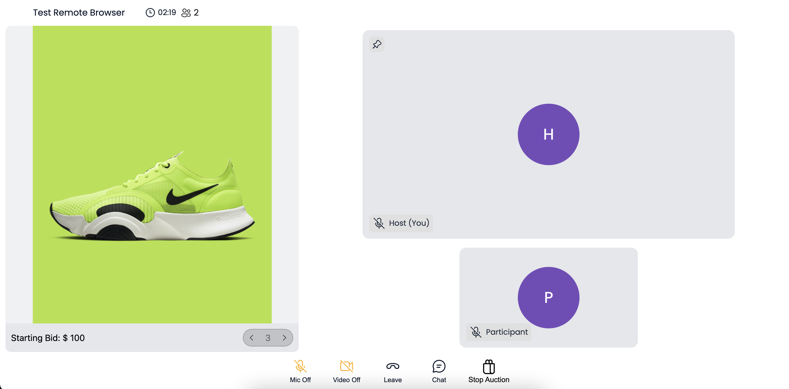
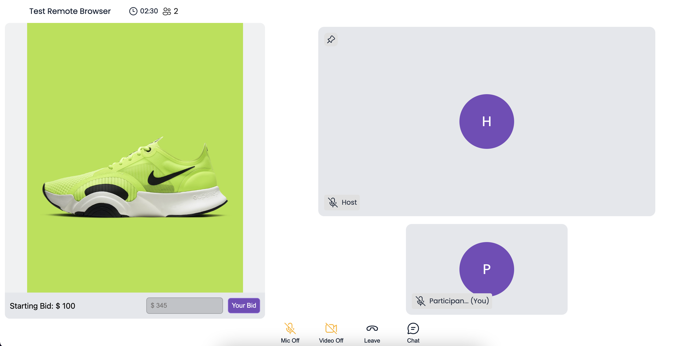

# Live Auction Example App

This example showcases how you can build a Live Auction App with RealtimeKit's React UI Kit!

A host presents items one at a time and bidders place bids on the item being shown. The auction state is shared with everyone in the session through a [meeting key-value store](https://developers.cloudflare.com/realtime/realtimekit/collaboration/meeting-key-value-store/).

## Features

- Custom setup screen that tells the user whether they are joining as the host or as a bidder
- Host can start and stop the auction and move between the auction items
- Starting the auction first starts the livestream and stopping it stops the livestream; the button shows a loading state for every host until the livestream has actually started or stopped
- Bidders can place a bid; everyone sees the highest bid and gets a notification for each new one
- Participants who join late see the ongoing auction, the current item and the highest bid
- Custom branding with `provideRtkDesignSystem`

## Prerequisites

The role is decided from the name of the preset the participant joins with:

- **Host**: any preset with `host` in its name (case-insensitive), for example `Livestream Host Demo`. The preset needs the livestream permission, otherwise the auction cannot be started.
- **Bidder**: any other preset, for example `Livestream Viewer Demo`

## Running the example

```sh
npm install
npm run dev
```

Open the dev server in your browser with an `authToken` in the URL. Use a token from a host preset in one tab and a token from a bidder preset in another.

```
http://localhost:5173/live-auction/?authToken=<your-token>
```

## How the auction state is synced

All the store code lives in the [`useAuction`](./src/hooks/useAuction.ts) hook. It creates a store named `auction` and keeps these keys in it:

| Key | Value | Updated by |
| --- | --- | --- |
| `started` | `boolean`, whether the auction is ongoing | Host |
| `transition` | `'starting'`, `'stopping'` or `null`, set while a host is starting or stopping the auction | Host |
| `item` | `number`, index of the item being shown from [`constants.ts`](./src/constants.ts) | Host |
| `bid-<item>` | `{ bid: number, user: string }`, highest bid for that item (for example `bid-0`), kept when the host moves between items | Bidders |

```ts
const store = await meeting.stores.create('auction');

// read the current state, also works for participants who join late
const { started, item, ...bids } = store.getAll();

// get notified when another participant changes a value
store.subscribe('*', (data) => console.log(data));

// update one or more values for everyone
await store.bulkSet([{ key: 'started', payload: true }]);
```

The hook returns the state along with `toggleAuction`, `showItem` and `placeBid`, so the components never touch the store directly.

## Screenshots

Host's UI:



Participants's UI:



[See source](./src/App.tsx)
